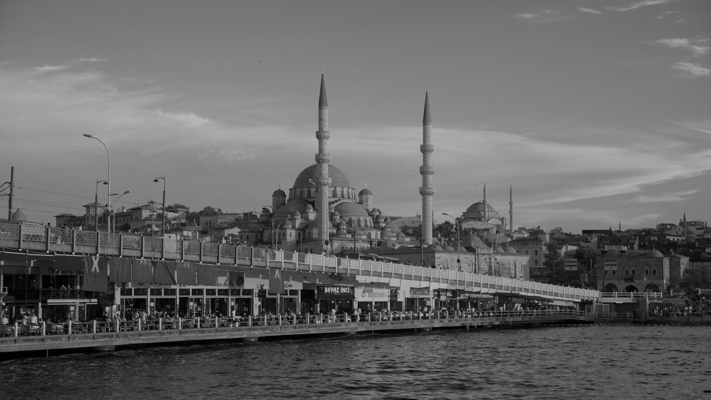
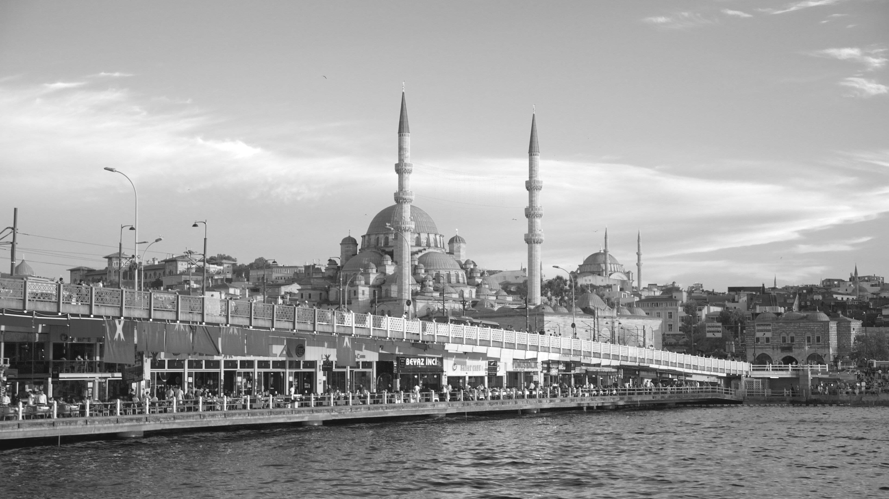
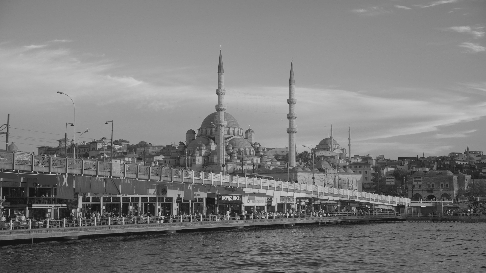

# Hafta 2 - Görev 5: Doğrusal Parlaklık ve Kontrast Dönüşümü Analizi

Bu çalışmada, yüksek çözünürlüklü (4K) \gorsel1.png\ görüntüsü üzerinde arama tablosu (Lookup Table - LUT) optimizasyonu kullanılarak doğrusal yoğunluk dönüşümü (\ = \alpha \cdot r + \beta\$) uygulanmış; kontrast sıkıştırma, seviye öteleme ve bileşik dönüşümün piksel dağılımı üzerindeki etkileri incelenmiştir.

---

## 1. Yöntem ve Algoritma Tasarımı

1. **Giriş Görüntüsü:**
   - Dosya Adı: \gorsel1.png\
   - Çözünürlük: **3840 x 2160** (\.294.400\$ piksel)
   - Kanal: Tek kanallı (8-bit Grayscale, [0, 255])

2. **Lookup Table (LUT) Tabanlı Dönüşüm:**
   - 8.3 milyon pikselin her biri için bağımsız kayan noktalı (float) çarpma ve toplama işlemi yapmak yerine, \$[0, 255]\$ aralığındaki 256 olası gri seviye değeri için sonuçlar önceden hesaplanarak 256 elemanlı bir arama tablosuna (\std::array<uchar, 256>\) kaydedilmiştir.
   - Pikseller \(1)\$ karmaşıklıkla bellek haritalaması üzerinden dönüştürülerek hesaplama maliyeti optimize edilmiştir.

3. **Uygulanan Dönüşüm Fonksiyonları:**
   - **Ölçekleme (Kontrast Sıkıştırma):** \ = 0.75 \cdot r\$
   - **Öteleme (Parlaklık Artırma):** \ = r + 20\$
   - **Bileşik Dönüşüm:** \ = \text{saturate\_cast}(0.75 \cdot r + 20)\$

---

## 2. İstatistiksel Ölçümler ve Karşılaştırma Tablosu

| Durum | Formül | Min Piksel | Max Piksel | Ortalama Ton |
| :--- | :--- | :---: | :---: | :---: |
| **Orijinal Görüntü** | \\$ | 0 | 255 | 137.94 |
| **Kontrast Daraltma** | \ = 0.75 \cdot r\$ | 0 | 191 | 103.58 |
| **Parlaklık Öteleme** | \ = r + 20\$ | 20 | 255 | 157.94 |
| **Bileşik Dönüşüm** | \ = 0.75 \cdot r + 20\$ | 20 | 211 | 123.58 |

---

## 3. Matematiksel Aralık ve Sınır Analizi

- **Kontrast Sıkıştırma (\.75r\$):** Maksimum piksel değeri \ \times 0.75 = 191.25 \rightarrow 191\$ seviyesine inmiştir. Yapılan histogram kontrolünde \$[192, 255]\$ aralığında **0 piksel** tespit edilmiş, görüntünün dinamik aralığının daraldığı doğrulanmıştır.
- **Parlaklık Öteleme (\ + 20\$):** Sıfır olan minimum piksel seviyesi \ + 20 = 20\$ değerine yükseltilmiştir. \$[0, 19]\$ aralığında **0 piksel** bulunmakta olup taban çizgisi yukarı kaydırılmıştır.
- **Bileşik Dönüşüm (\.75r + 20\$):** Görüntünün yeni dinamik aralığı kesin olarak \$[20, 211]\$ aralığına sıkıştırılmıştır. Hem \$[0, 19]\$ aralığında hem de \$[212, 255]\$ aralığında **0 piksel** ölçülerek doğrusal dönüşümün teorik sınırları deneysel olarak kanıtlanmıştır.

---

## 4. Görsel Çıktılar

| Orijinal | Kontrast (.75r$) | Parlaklık (+20$) | Bileşik (.75r+20$) |
| :---: | :---: | :---: | :---: |
|  |  |  |  |
