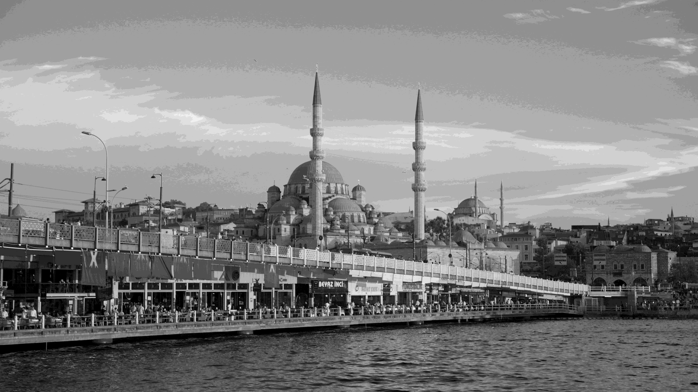

# Hafta 2 - Görev 6: 4 Kadran (2x2 Grid) ile Paralel Bitsel Kuantalama ve Thread Analizi

Bu çalışmada, 4K çözünürlükteki tek kanallı gri seviye test görseli üzerinde bit düzeyinde maskeleme tekniği (\itwise AND\) kullanılarak genlik kuantalaması (8-bit -> 4-bit) gerçekleştirilmiştir. İşlem, görüntüyü 4 kadrana (2x2 grid / quadrants) bölerek \std::thread\ ile paralel koşturulmuş ve tek çekirdek (sequential) çalışma süresiyle mikrosaniye hassasiyetinde karşılaştırılmıştır.

---

## 1. Yöntem ve Algoritma Tasarımı

1. **Giriş Görüntüsü ve Çözünürlük:**
   - Görüntü: \gorsel1.png\
   - Çözünürlük: **3840 x 2160** (\.294.400\$ piksel)
   - Kanal: 8-bit Grayscale (\^8 = 256\$ gri seviyesi)

2. **Bitsel Maskeleme ile Hızlı Kuantalama (Bitwise Quantization):**
   - 8-bitlik piksel değerlerini 4-bit seviyesine (\^4 = 16\$ gri tonu) düşürmek için bölme/çarpma gibi maliyetli aritmetik işlemler yerine işlemci seviyesinde doğrudan bit kaydırma ve maskeleme kullanılmıştır:
     main\text{Maske} = \text{static\_cast<uchar>}(0\text{xFF} \ll (8 - 4)) = 0\text{xF0} \quad (11110000_2)main
   - Piksel değerleri bu maske ile mantıksal VE işlemine (\p[j] &= 0xF0\) tabi tutularak en anlamsız 4 bit (LSB) sıfırlanmış, sadece en anlamlı 4 bit (MSB) korunmuştur.

3. **Uzamsal Bölümleme (4 Kadran - 2x2 Grid):**
   - Görüntü matrisi bellek kopyalaması yapılmadan \cv::Rect\ ile 4 bağımsız kadrana bölünmüştür:
     - **Sol-Üst Kadran:** \[0, 0, w1, h1]\
     - **Sağ-Üst Kadran:** \[w1, 0, w2, h1]\
     - **Sol-Alt Kadran:** \[0, h1, w1, h2]\
     - **Sağ-Alt Kadran:** \[w1, h1, w2, h2]\
   - Her bir kadrana bağımsız bir \std::thread\ atanmış, çekirdekler arası bellek çakışması (race condition) olmadan işlem tamamlanmıştır.

---

## 2. Performans ve Çalışma Süresi Ölçümü

Ölçümler \std::chrono::high_resolution_clock\ kullanılarak 30 iterasyonun ortalaması alınarak yapılmıştır:

| Yöntem | Çalışma Süresi ($\mu\text{s}$) | Çalışma Süresi (ms) | Hızlanma (Speedup) |
| :--- | :---: | :---: | :---: |
| **Tek Çekirdek (Sequential)** | **1476.06 $\mu\text{s}$** | **1.476 ms** | 1.00x (Referans) |
| **4 Thread (Paralel 2x2 Kadran)** | **2097.85 $\mu\text{s}$** | **2.097 ms** | **~0.70x** |

---

## 3. Mühendislik Değerlendirmesi ve Çıkarımlar

- **Neden 8.3 Milyon Pikselde Paralel Yapı Hızlanmadı (\.70\times\$)?**
  - **Operasyonun Donanımsal Hafifliği:** Bitsel VE (\p[j] &= mask\) işlemi modern x86/ARM işlemcilerde tek çevrimde (1 CPU clock cycle) tamamlanan en ilkel makine komutlarından biridir. 8.3 milyon piksel dahi tek çekirdekte yalnızca 1.47 milisaniyede tamamlanmaktadır.
  - **İş Parçacığı Yönetim Maliyeti (Thread Overhead):** \std::thread\ nesnelerinin oluşturulması, işletim sistemi çekirdeğine (kernel) devredilmesi, 4 kadrana yönlendirilmesi ve işlem sonunda \join()\ ile ana izleğe senkronize edilmesi mikrosaniye bazında ek bir yük getirmektedir.
  - **Bellek Bant Genişliği Darboğazı (Memory Bus Contention):** Aritmetik karmaşıklık yok denecek kadar az olduğu için asıl darboğaz CPU çekirdekleri değil, 4 çekirdeğin aynı anda L3 Cache ve RAM veri yolundan piksel verisi çekmeye çalışmasıdır.
  - **Sonuç:** Çoklu iş parçacığı mimarisi; konvolüsyon (Sobel, Gaussian), matris çarpımı veya karmaşık trigonometrik/üstel hesaplamalar gibi işlemciyi meşgul eden algoritmalar için uygundur. Bellek-yoğun (memory-bound) ve tek çevrimlik basit bit işlemlerinde tek çekirdeğin önbellek dostu sıralı akışı daha verimlidir.

---

## 4. Görsel Çıktılar

| Orijinal Görüntü (8-bit / 256 Seviye) | 4-bit Kuantalanmış Görüntü (16 Seviye) |
| :---: | :---: |
|  |  |

Kuantalama sonucunda piksellerin en düşük 4 biti sıfırlandığı için parlaklık geçişlerinde belirgin posterizasyon (kontur bantlaşması) oluştuğu gözlemlenmiştir.
